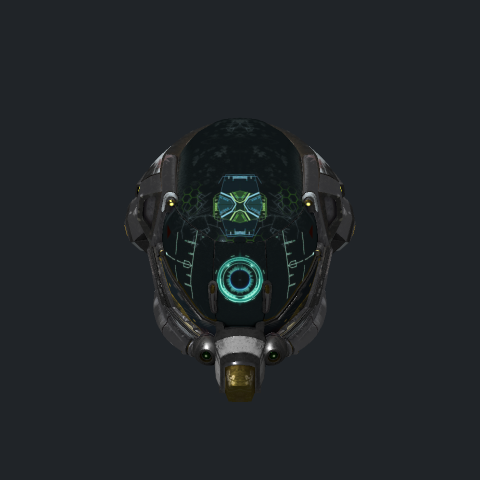
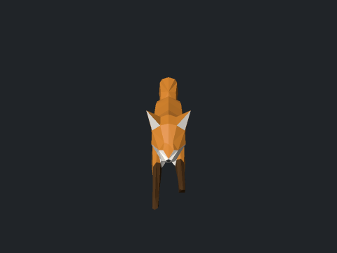
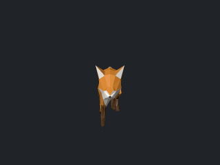
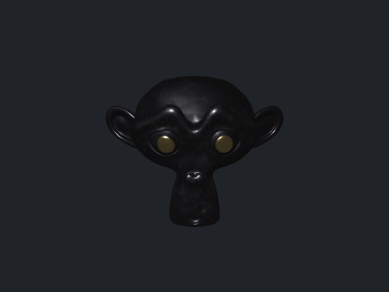
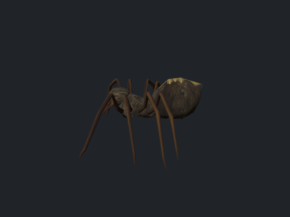
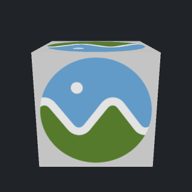
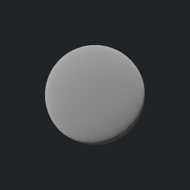
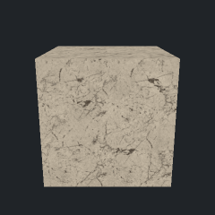

# Model render

Draws a 3D model to a picture with `std.gfx.scene`: glTF, GLB, OBJ or STL in, a PNG (or any image format) out, or an animated GIF of the model's animation.

```bash
adm run --release gfx/model-render/render.adm -- gfx/model-render/models/Fox/Fox.glb fox.png
adm run --release gfx/model-render/render.adm -- gfx/model-render/models/Fox/Fox.glb fox.gif
```

Options after the two files:

| Option | Meaning |
|---|---|
| `--size WxH` | picture size, 640x480 by default |
| `--samples N` | pixels drawn per output pixel along each axis, 1 to 4; 2 by default |
| `--time T` | seconds into the animation for a still picture; 0 by default |
| `--frames N` | frames of a GIF over the animation's length; 24 by default |
| `--background #rgb` | the background colour, transparent by default |
| `--camera NAME` | the node whose camera to look through; the model's first camera, or one placed in front of the scene, by default |

The code is in [render.adm](render.adm): `models.load` reads the file, `scene.render` draws it, `picture.save` writes it. For a GIF, the frames are drawn at times spread over the longest animation and handed to the GIF codec of `std.formats.image`.

## The models

The folder [models](models) holds models in each format the program reads, with their licences beside them:

| Model | Format | From |
|---|---|---|
| [Fox](models/Fox) | GLB, skinned, three animations | Khronos glTF Sample Assets, CC0 |
| [DamagedHelmet](models/DamagedHelmet) | GLB, every PBR texture | Khronos glTF Sample Assets, CC BY 4.0 (theblueturtle_) |
| [Suzanne](models/Suzanne) | glTF with files beside it | Khronos glTF Sample Assets, CC0 |
| [AnimatedCube](models/AnimatedCube) | glTF, a rotation animation | Khronos glTF Sample Assets, CC0 |
| [BoxTextured](models/BoxTextured) | GLB, one texture | Khronos glTF Sample Assets, CC BY 4.0 (Cesium) |
| [spider](models/spider) | OBJ with a material library and five textures | Open Asset Import Library test models, BSD-3-Clause |
| [sphere.stl](models/sphere.stl) | binary STL | ADM samples |

## Pictures

The pictures below come from the commands under each, run from the repository root.



```bash
adm run --release gfx/model-render/render.adm -- gfx/model-render/models/DamagedHelmet/DamagedHelmet.glb helmet.png --size 480x480 --background "#202428"
```



```bash
adm run --release gfx/model-render/render.adm -- gfx/model-render/models/Fox/Fox.glb fox.png --size 480x360 --time 0.4 --background "#202428"
```



```bash
adm run --release gfx/model-render/render.adm -- gfx/model-render/models/Fox/Fox.glb fox.gif --size 320x240 --frames 20 --background "#202428"
```



```bash
adm run --release gfx/model-render/render.adm -- gfx/model-render/models/Suzanne/Suzanne.gltf suzanne.png --size 480x360 --background "#202428"
```



```bash
adm run --release gfx/model-render/render.adm -- gfx/model-render/models/spider/spider.obj spider.png --size 480x360 --background "#202428"
```



```bash
adm run --release gfx/model-render/render.adm -- gfx/model-render/models/BoxTextured/BoxTextured.glb box.png --size 320x320 --background "#202428"
```

 

```bash
adm run --release gfx/model-render/render.adm -- gfx/model-render/models/sphere.stl sphere.png --size 320x320 --background "#202428"
adm run --release gfx/model-render/render.adm -- gfx/model-render/models/AnimatedCube/AnimatedCube.gltf cube.gif --size 240x240 --frames 24 --background "#202428"
```

On this machine (release build) the helmet's 15 452 triangles with five 2048x2048 textures draw at 480x480 with two samples a pixel in 0.5 s (building the textures' mipmaps included), the fox's 576 in 60 ms, and the fox GIF's twenty frames in 0.7 s.
